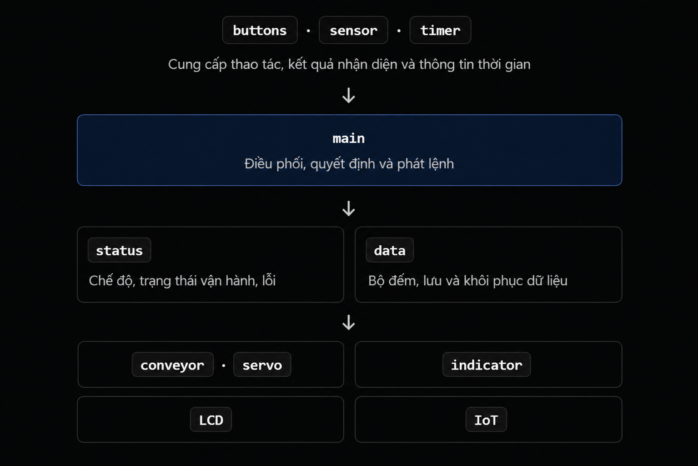

# FIRMWARE ARCHITECTURE – MINI CONVEYOR SORTING SYSTEM

## 1. Tổng quan

Firmware được xây dựng cho hệ thống băng tải phân loại sản phẩm theo chiều cao, sử dụng vi điều khiển STM32F103C8T6.

Kiến trúc firmware được chia thành 11 module, mỗi module đảm nhiệm một nhóm chức năng riêng. Các module được tổ chức theo từng tầng, trong đó `main` giữ vai trò điều phối hoạt động, tiếp nhận thông tin đầu vào và phát lệnh đến các module chức năng.

Kiến trúc này nhằm phân chia rõ trách nhiệm giữa các module, tạo thuận lợi cho quá trình phát triển, kiểm thử và bảo trì firmware.

## 2. Sơ đồ kiến trúc

Sơ đồ kiến trúc firmware gồm 3 tầng chính:

- **Tầng đầu vào:** `buttons`, `sensor`, `timer`.
- **Tầng điều phối:** `main`.
- **Tầng chức năng:** `status`, `data`, `conveyor`, `servo`, `indicator`, `LCD`, `IoT`.

Sơ đồ thể hiện cấu trúc và mối liên hệ tổng quát giữa các module:

## 3. Danh sách module và chức năng

| STT | Module | Chức năng |
|---:|---|---|
| 1 | `buttons` | Tiếp nhận và xử lý thao tác từ các nút nhấn điều khiển hệ thống. |
| 2 | `sensor` | Tiếp nhận tín hiệu cảm biến, xử lý và cung cấp kết quả nhận diện sản phẩm. |
| 3 | `timer` | Cung cấp thông tin thời gian và các chức năng định thời phục vụ hoạt động của hệ thống. |
| 4 | `main` | Điều phối hoạt động tổng thể, xử lý thông tin đầu vào và phát lệnh đến các module chức năng. |
| 5 | `status` | Quản lý chế độ hoạt động, trạng thái vận hành và trạng thái lỗi của hệ thống. |
| 6 | `data` | Quản lý dữ liệu bộ đếm, lưu trữ và khôi phục dữ liệu. |
| 7 | `conveyor` | Điều khiển hoạt động của động cơ băng tải. |
| 8 | `servo` | Điều khiển vị trí và hoạt động của động cơ servo. |
| 9 | `indicator` | Điều khiển các thiết bị báo hiệu, bao gồm LED và buzzer. |
| 10 | `LCD` | Hiển thị thông tin về trạng thái, chế độ hoạt động, bộ đếm và lỗi của hệ thống. |
| 11 | `IoT` | Phục vụ chức năng giao tiếp Wi-Fi và giám sát hệ thống từ xa. |

## 4. Mối liên hệ và luồng hoạt động giữa các module

### 4.1. Tầng đầu vào

Gồm ba module `buttons`, `sensor` và `timer`.

- `buttons` cung cấp thông tin về thao tác điều khiển từ người dùng.
- `sensor` cung cấp kết quả nhận diện sản phẩm từ các cảm biến.
- `timer` cung cấp thông tin thời gian phục vụ việc xử lý các tác vụ có yêu cầu định thời.

Các thông tin này được cung cấp cho `main` để phục vụ quá trình điều phối hoạt động.

### 4.2. Tầng điều phối

Module `main` là trung tâm điều phối của firmware.

Nhiệm vụ chính:

- Tiếp nhận thông tin từ các module đầu vào.
- Xử lý và quyết định hoạt động tiếp theo của hệ thống.
- Phối hợp với các module quản lý trạng thái và dữ liệu.
- Phát lệnh đến các module điều khiển, hiển thị và giao tiếp.

### 4.3. Tầng chức năng

Gồm bảy module `status`, `data`, `conveyor`, `servo`, `indicator`, `LCD` và `IoT`.

- `status` quản lý chế độ, trạng thái vận hành và lỗi.
- `data` quản lý bộ đếm, lưu trữ và khôi phục dữ liệu.
- `conveyor` và `servo` thực hiện điều khiển các cơ cấu chấp hành.
- `indicator` điều khiển các thiết bị báo hiệu trạng thái và lỗi.
- `LCD` hiển thị thông tin vận hành tại hệ thống.
- `IoT` phục vụ chức năng giám sát hệ thống thông qua kết nối Wi-Fi.

Các module này phối hợp với `main` để thực hiện chức năng tương ứng trong quá trình vận hành.

## 5. Nguyên tắc thiết kế

- Mỗi module đảm nhiệm một nhóm chức năng riêng, hạn chế trùng lặp trách nhiệm.
- `main` giữ vai trò điều phối, không trực tiếp đảm nhiệm toàn bộ xử lý của các module chức năng.
- Hạn chế phụ thuộc trực tiếp giữa các module khi không cần thiết.
- Việc quản lý trạng thái, dữ liệu và điều khiển phần cứng cần được phân chia rõ ràng theo chức năng của từng module.
- Chi tiết về trách nhiệm, giao diện hàm (API), dữ liệu và quan hệ phụ thuộc của từng module được trình bày trong các tài liệu thiết kế tương ứng thuộc thư mục `module_design/`.
